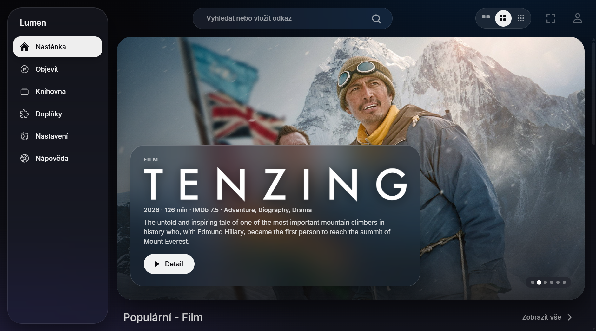
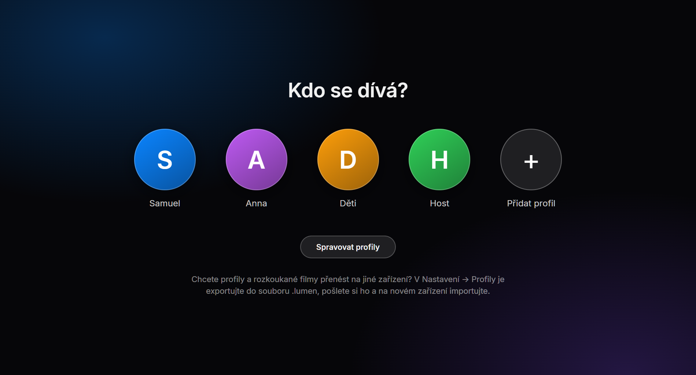
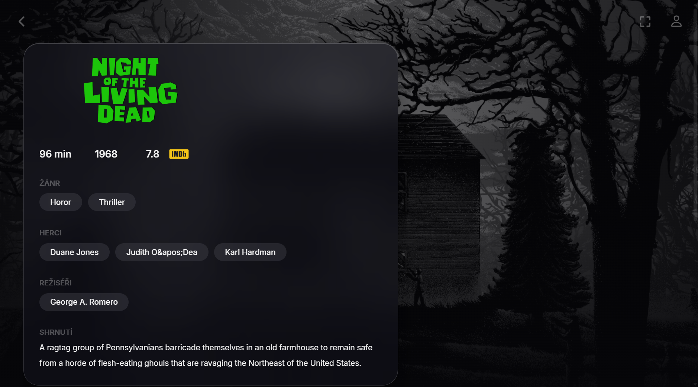
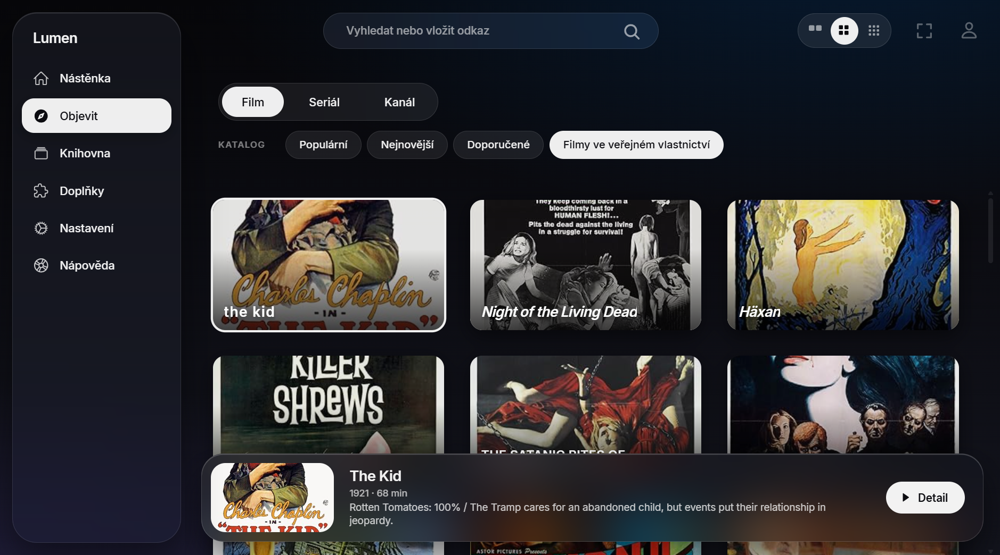
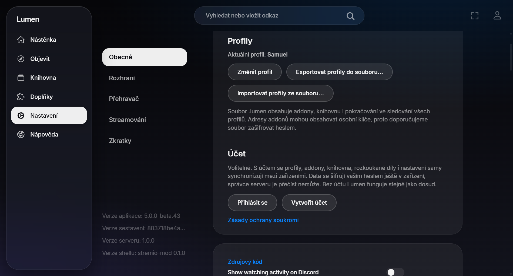
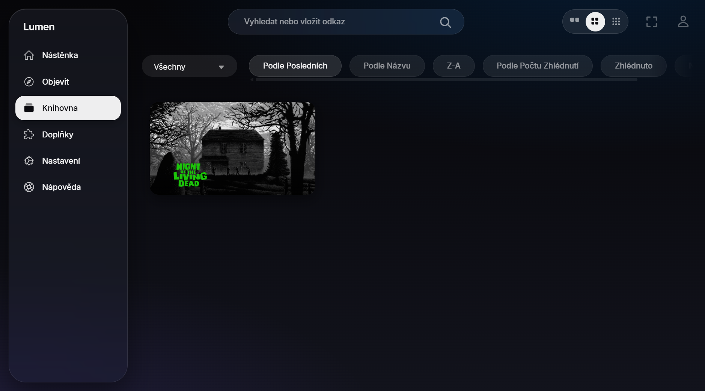
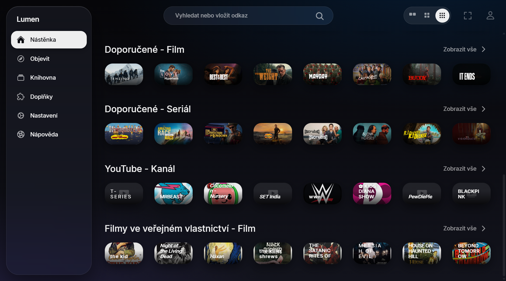
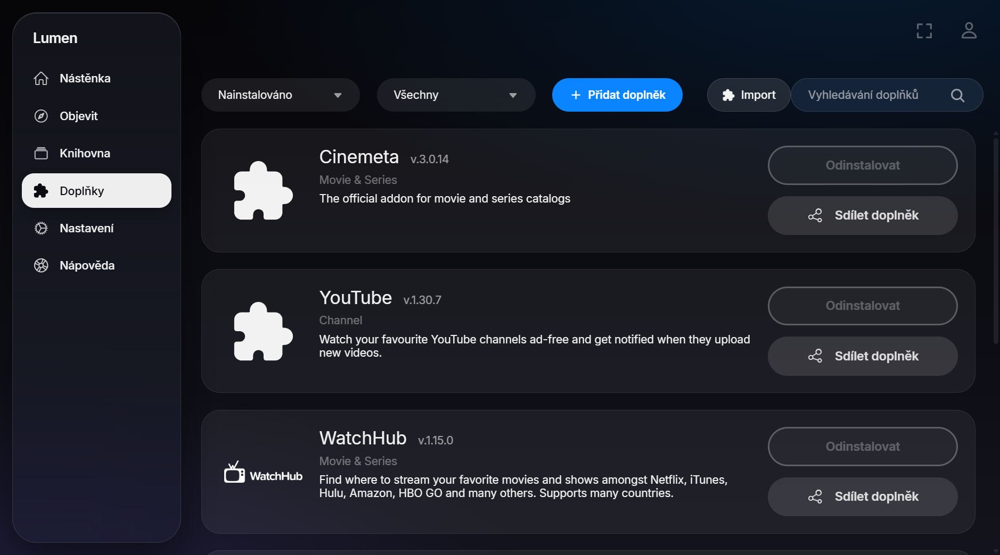
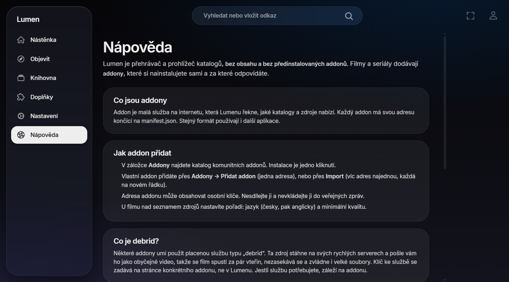

<div align="center">


# Lumen

**Tmavý „skleněný" prohlížeč a přehrávač filmů a seriálů pro Windows, macOS a Android TV** 🎬✨
s automatickým HDR (ve Windows), profily a volitelnou synchronizací šifrovanou od konce ke konci.

[](../../releases/latest)
[](#-instalace)
[-bf5af2?style=for-the-badge&logo=apple&logoColor=white)](#-instalace)
[](#-instalace)
[](#-funkce)
[](LICENSE)

🇬🇧 [English version](README.md)

</div>

> [!WARNING]
> **Toto není návod ke stahování nelegálního obsahu.** Lumen je pouze přehrávač a neposkytuje vůbec žádný obsah. Všechny odkazy vedou na služby třetích stran. Používejte výhradně obsah, ke kterému máte autorská práva. Vše děláte čistě na vlastní odpovědnost.



## 📸 Ukázky

<table>
  <tr>
    <td width="50%"><br><sub>👥 <b>Kdo se dívá?</b> Profily s vlastními barvami a volitelným PINem</sub></td>
    <td width="50%"><br><sub>🎞️ <b>Detail</b> s velkým pozadím a kartou informací</sub></td>
  </tr>
  <tr>
    <td><br><sub>🧭 <b>Objevit</b> s čipy katalogů a žánrů</sub></td>
    <td><br><sub>☁️ <b>Volitelný účet</b> synchronizuje vše, šifrovaně od konce ke konci</sub></td>
  </tr>
  <tr>
    <td><br><sub>📚 <b>Knihovna</b> a pokračování ve sledování</sub></td>
    <td><br><sub>🔍 <b>Tři velikosti dlaždic</b>: tady ta malá</sub></td>
  </tr>
  <tr>
    <td><br><sub>🧩 <b>Addony</b>: jedním klikem, jednou adresou nebo více adres najednou</sub></td>
    <td><br><sub>💡 <b>Vestavěná nápověda</b> česky i anglicky</sub></td>
  </tr>
</table>

## ✨ Funkce

### 🎨 Vzhled
- **Rozhraní ve stylu Apple TV / iOS 26**: tmavé průsvitné „skleněné" panely, písmo Inter, velký 16:9 banner na domovské stránce.
- 🏠 **Domů**: obří doporučený banner (střídá se, bez videí a trailerů) s logem titulu, rokem, délkou, žánry a popisem. Klik na dlaždici ji zobrazí v banneru, druhý klik (nebo *Detail*) ji otevře.
- 🧭 **Objevit**: přepínač typu (filmy / seriály / kanály), čipy katalogů a žánrů, široké dlaždice, panel s informacemi o vybrané položce.
- 🏷️ **Logo titulu na každé dlaždici** (když logo chybí, nápis názvu několika styly písma).
- 🔍 **Tři velikosti náhledů** (velké / střední / malé) na domovské stránce, v Objevit, Knihovně a vyhledávání; pamatují se.

### 👥 Profily
- Každý má **vlastní addony, knihovnu a „pokračovat ve sledování"**, volitelně s **PINem**.
- Profil vyberete při startu nebo ho přepnete v nabídce vpravo nahoře.
- Všechny profily lze exportovat do souboru `.lumen` (volitelně chráněného heslem) a naimportovat na jiném zařízení.

### ☁️ Účet a synchronizace (volitelné, novinka ve verzi 1.2)
- **Účet nepotřebujete.** Bez něj zůstává všechno u vás v počítači, stejně jako dřív.
- S bezplatným účtem Lumen mezi vašimi zařízeními synchronizuje **profily, addony, knihovnu, rozkoukané díly i nastavení**.
- 🔒 **Šifrování od konce ke konci**: data se šifrují ve vašem zařízení klíčem odvozeným z hesla. Server (ani autor) je **nemůže přečíst**.
- Registrace **kódem z e-mailu**, zapomenuté heslo se obnoví stejně a **účet můžete kdykoli smazat** v Nastavení.
- Přečtěte si [zásady ochrany soukromí](docs/PRIVACY.md).

### 🎬 Přehrávač a HDR
- **Přehrávač mpv**: hardwarové dekódování, synchronizace s displejem, nabídky titulků a zvukových stop, **načtení titulků ze souboru** (.srt / .vtt), skleněná ovládací lišta, která se sama skryje.
- 🌈 **Automatické HDR ve Windows**: při přechodu do fullscreenu s HDR / Dolby Vision videem se zapne HDR na daném displeji a po skončení se vrátí (a obnoví se i po pádu aplikace). Pokud jste měli HDR zapnuté už před tím, zůstane tak. *(Jen ve Windows. Verze pro macOS zatím přehrává HDR videa v SDR.)*

### 🧩 Addony a zdroje
- Komunitní addony jedním klikem, přidání jedné adresy, nebo **import více adres najednou**. Nic není předinstalované.
- 🎯 **Preference zdrojů**: řazení podle jazyka (česky → anglicky) a minimální kvality (4K / Full HD) pro výsledky jakéhokoli addonu.
- 🌐 **Vestavěný streamovací server**: přímé odkazy i torrenty fungují hned, bez další aplikace.

### 📦 Ostatní
- 🇨🇿 **Česky jako výchozí jazyk**, 🇬🇧 k dispozici angličtina (rozhraní, nápověda i všechny přidané texty).
- **Instalátor pro Windows**: jediný `Lumen-Setup.exe` (instalace pro uživatele, zástupci, odinstalace) obsahuje všechno.
- 🍎 **Instalátor pro macOS**: jediný `Lumen-1.2.4.dmg`, stačí přetáhnout Lumen do Aplikací. Obsahuje i přehrávač a streamovací server. Verze pro macOS je nová v 1.2.2; zdrojové kódy jsou ve složce [`macos/`](macos).

## 💻 Požadavky

**Windows**
- Windows 10 / 11 (x64) s **WebView2 runtime** (ve Windows 11 už je).
- Nic dalšího instalovat nemusíte: instalátor obsahuje přehrávací knihovnu (libmpv) i lokální streamovací server (Node.js + WebTorrent).
- Displej s podporou HDR, pokud chcete automatické HDR (nepovinné).

**macOS**
- macOS 12 Monterey nebo novější na **Macu s Apple Silicon** (M1 a novější). Macy s procesorem Intel zatím nejsou podporované.
- Nic dalšího instalovat nemusíte: aplikace obsahuje přehrávací knihovnu (libmpv) i lokální streamovací server (Node.js + WebTorrent).

**Android TV / Google TV**
- Android TV 7.0 nebo novější (televize, Chromecast s Google TV, Shield, Mi Box…). Jen přímé odkazy, bez torrentů.

## 🚀 Instalace

### 🪟 Windows

1. Stáhněte **`Lumen-Setup.exe`** z [nejnovějšího vydání](../../releases/latest).
2. Spusťte ho. Soubor není podepsaný, takže Windows SmartScreen může varovat: *Další informace → Přesto spustit*.
3. Spusťte **Lumen** ze zástupce na ploše nebo z nabídky Start.

Odinstalace: *Nastavení → Aplikace* (nebo `Uninstall.exe` v instalační složce). Instalátor se zeptá, jestli smazat i vaše data.

### 🍎 macOS

1. Stáhněte **`Lumen-1.2.4.dmg`** z [nejnovějšího vydání](../../releases/latest).
2. Otevřete ho a **přetáhněte Lumen do složky Aplikace** (šipka v okně ukazuje kam).
3. Spusťte **Lumen** ze složky Aplikace (nebo z Launchpadu). Aplikace není podepsaná Apple Developer ID, takže ji macOS poprvé zablokuje hláškou *„Soubor Lumen nebyl otevřen – Společnosti Apple se nepodařilo ověřit, že soubor Lumen neobsahuje malware…"*. To je v pořádku. Klikněte na **Hotovo** (**ne** na *Přesunout do koše*).
4. Povolte ji jednou v nastavení:
   1. Otevřete **Nastavení systému → Soukromí a zabezpečení**.
   2. Sjeďte úplně dolů do části **Zabezpečení**. Uvidíte *„Soubor Lumen byl v zájmu ochrany Macu zablokován"*.
   3. Klikněte na **Přesto otevřít**, potvrďte heslem nebo Touch ID a v dalším okně klikněte na **Otevřít**.

   Děláte to jen jednou, pak se Lumen otevírá normálně. Na starším macOS (12–14) stačí **pravé tlačítko na Lumen → Otevřít → Otevřít**.

   Pokud macOS hlásí, že je aplikace *poškozená*, spusťte v Terminálu tento příkaz a otevřete ji znovu:
   ```bash
   xattr -dr com.apple.quarantine /Applications/Lumen.app
   ```

Odinstalace: přetáhněte Lumen ze složky Aplikace do Koše. Pokud chcete smazat i data, odstraňte `~/Library/WebKit/io.github.samuelthomask.lumen`, `~/Library/Application Support/Lumen` a `~/Library/Caches/io.github.samuelthomask.lumen`.

### 📺 Android TV / Google TV (beta, novinka v 1.3.0)

1. Na televizi otevřete **Obchod Google Play**, vyhledejte aplikaci **Downloader** (od AFTVnews) a nainstalujte ji.
2. Povolte jí instalovat aplikace: *Nastavení → Aplikace → Zabezpečení a omezení → Neznámé zdroje* → zapněte **Downloader**. (Na Google TV: *Nastavení → Systém → Informace* → 7× klikněte na *Sestavení OS Android TV*, tím zapnete režim vývojáře, a pak *Nastavení → Aplikace → Zabezpečení a omezení → Neznámé zdroje*.)
3. Otevřete Downloader a do pole pro adresu napište kód **`8216339`**. Vede vždycky na nejnovější verzi.
   <sub>(Nebo celou adresu: `https://github.com/samuelthomask/Lumen/releases/latest/download/Lumen-AndroidTV.apk`)</sub>
4. Klikněte na **Go**, počkejte na stažení a klikněte na **Instalovat**. Pak na **Otevřít** (Lumen najdete i mezi aplikacemi).
5. Všechno ovládáte šipkami, tlačítkem **OK** a **Zpět** na ovladači. V přehrávači stiskněte **OK** nebo šipku a ukáže se lišta (titulky, zvuk, rychlost).

Aktualizace: nové APK nainstalujete stejně, přes starou verzi, data zůstanou. Na televizi se aplikace sama neaktualizuje.
Odinstalace: *Nastavení → Aplikace → Lumen → Odinstalovat*.

> [!NOTE]
> Na Android TV hrají jen zdroje s **přímým odkazem** (např. přes debrid službu). **Torrenty tam nefungují** (chybí vestavěný streamovací server). Lumen nejde na televizích LG (webOS) ani Samsung (Tizen), jen na zařízeních s Android TV / Google TV (např. Chromecast s Google TV, Nvidia Shield, Xiaomi Mi Box, televize Sony, Philips, TCL).

## 🍿 Jak získat obsah a addony

Lumen slouží jen jako přehrávač, v základu je úplně prázdný – bez obsahu a bez předinstalovaných doplňků (addonů). Filmy a seriály do něj dostanete právě pomocí komunitních addonů, které si musíte sami nainstalovat. Lumen podporuje stejný systém doplňků jako populární aplikace Stremio.

> [!IMPORTANT]
> **Přehrávání z P2P sítí (torrentů):** přehrávání pomocí komunitních addonů fungujících na bázi torrentů se bude téměř jistě sekat, načítat celou věčnost nebo se video vůbec nespustí, protože jste závislí na rychlosti sdílení ostatních uživatelů internetu. Pro plynulé sledování (obzvlášť u 4K videí) a pro bezpečí vaší IP adresy je nutné využívat tzv. **debrid služby**, které filmy stahují bleskově na své rychlé servery a vám je pak plynule streamují.

**Kde najít návod?**
Z důvodu dodržování pravidel GitHubu zde neuvádíme konkrétní názvy ani přímé odkazy na addony. Kompletní komunitní návod, jak aplikaci nastavit a jak propojit debrid služby s příslušnými addony pro plynulé a levné sledování, naleznete zde:

👉 **[Kompletní komunitní návod na nastavení najdete ZDE](https://rentry.co/4mmr8vxy)**

## 🔒 Soukromí

Lumen funguje i bez účtu a jeho rozhraní neposílá žádné analytické události. Síťové požadavky ale dělá tam, kam to potřebuje: na servery addonů, které nainstalujete, servery s obrázky (plakáty, pozadí, loga) a veřejnou službu s popisy filmů. Vestavěné jádro aplikace může kontaktovat své výchozí katalogové služby. Knihovna, nastavení a adresy addonů jsou uložené lokálně (Windows: `%LOCALAPPDATA%\StremioMod`, macOS: `~/Library/WebKit/io.github.samuelthomask.lumen`).

Pokud si vytvoříte volitelný účet, ukládá se jen váš e-mail a jeden **zašifrovaný** balík (Supabase, EU). Podrobnosti v [zásadách ochrany soukromí](docs/PRIVACY.md).

## 📄 Licence

GPL-2.0 – viz [LICENSE](LICENSE) a [NOTICE.md](NOTICE.md). Projekt nemá nic společného se Stremiem. Lumen neobsahuje žádný obsah; za addony a služby, které používáte, odpovídáte sami.

<div align="center">

Vytvořil s 💙 **Samuel Thomas Konečný** · [Instagram](https://www.instagram.com/samuelthomasko)

</div>
